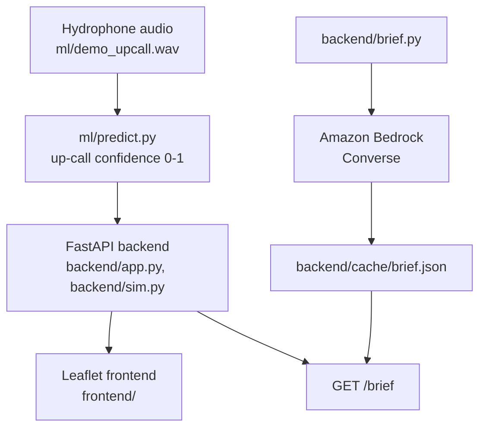

# RightWay

**Hear the whale. Slow the ship.**

RightWay detects North Atlantic right whale up-calls from hydrophone audio,
issues a 10 nm slow zone, shows simulated ship responses, and generates an AI
brief for harbor authorities.

## Problem

The North Atlantic right whale is critically endangered, and vessel strikes are
one of the leading causes of death. Seasonal and dynamic slow zones reduce
strike risk, but they depend on knowing where whales actually are. Acoustic
detection of up-calls is one way to locate whales in near real time so that
slow zones can be issued where they matter.

## Why RightWay: closing the loop

Since 2008, a network of acoustic auto-detection buoys built by the Cornell Lab
of Ornithology and the Woods Hole Oceanographic Institution has listened for
right whale calls along the Boston shipping lanes and alerted passing ships. But
the response is uneven: slowing down near a detection is mandatory only for LNG
carriers, while every other ship is merely encouraged to slow, and whether ships
actually slow down after an alert is not measured. RightWay's contribution is
that missing compliance loop — it tracks each vessel's speed before and after an
alert, computes a compliance percentage, and generates a plain-language brief
that names any non-complying vessel. Detection in RightWay is a stand-in for
real detection systems, not a replacement.

Sources: [WHOI press release](https://www.whoi.edu/press-room/news-release/new-whale-detection-buoys-will-help-ships-take-the-right-way-through-marine-habitat) · [DOSITS: real-time passive acoustic sensors](https://dosits.org/galleries/technology-gallery/observing-and-monitoring-marine-animals/real-time-passive-acoustic-sensors/)

## Solution

Hydrophone up-call detection -> a 10 nm slow zone around the detection ->
simulated ship responses (slow down or not) -> an AI brief summarizing the
situation for harbor authorities.

## Architecture


<!-- TODO verify after frontend merge: backend/app.py, backend/sim.py and frontend/ are not pushed yet; described from .kiro/steering/structure.md -->

Endpoints (from `structure.md`):

- `GET /vessels` -> `[{id,name,type,lat,lon,heading,speed,status}]`, status in `normal|alerted|complying|not_complying`
- `POST /detections {"hydrophone_id","wav"}` -> `{detection_id, hydrophone_id, confidence, zone{lat,lon,radius_nm}, vessels_in_zone[{id,name,speed_before}], synthetic_demo_clip:true, simulated:true}`
- `GET /compliance` -> `{compliance_pct, vessels[{id,name,before,after,status}]}`
- `GET /brief` -> `{"brief","source":"bedrock"|"cache"}`, read from `backend/cache/brief.json`
- `GET /stats` -> `{detections, alerts_sent, compliance_pct, simulated:true}`, from sim events only
- `POST /reset`

## How we built it in Kiro

**Steering** (`.kiro/steering/`):

- `product.md` — product scope, honesty rules, the metrics rule, and required UI/docs copy.
- `tech.md` — stack (FastAPI, pytest, ruff, torch + librosa, Leaflet, Bedrock) and the `.venv` rule.
- `structure.md` — ownership, the API contract, the demo canon, and the workflow.

**Specs** (`.kiro/specs/`):

- `classifier/` — documents the ML pipeline (synthetic data -> features -> CNN -> `predict()`).
- `ai-brief/` — `backend/brief.py`: Bedrock brief with a cached fallback.
- `backend-sim/` — vessel simulation + FastAPI endpoints. <!-- TODO verify after frontend merge: spec not created yet -->
- `frontend-map/` — Leaflet map UI. <!-- TODO verify after frontend merge: spec not created yet -->

**Hooks** (`.kiro/hooks/`):

- `lint-and-test.json` — on save of a `*.py` file, runs venv `ruff` on the file and `pytest` for its top-level folder.
- `readme-reminder.json` — on changes under `.kiro/specs/`, reminds us to update this README's Architecture and "How we built it in Kiro" sections.
- `honesty-guard.json` — on save of `frontend/`, `README.md`, or `docs/`, checks the file against `product.md`'s required copy and metrics rule, enforcing the honesty/copy rules.

## Run it

Setup:

```bash
python3 -m venv .venv
source .venv/bin/activate
pip install -r requirements.txt
```

Backend:

```bash
uvicorn backend.app:app --port 8000
```
<!-- TODO verify after frontend merge: backend/app.py not pushed yet -->

Frontend:

```bash
cd frontend && python -m http.server 5500
# open http://localhost:5500
```
<!-- TODO verify after frontend merge: frontend/ not pushed yet -->

Tests:

```bash
ruff check . && pytest -q
```

Regenerating assets:

```bash
python -m ml.cache_demo        # writes ml/demo_result.json from predict()
python -m backend.brief        # needs AWS_REGION and BEDROCK_MODEL_ID;
                               # falls back to the cached brief otherwise
```

## Data and honesty

- All vessel data is **simulated**; API responses include `"simulated": true`.
- The classifier is trained on **synthetic** up-calls because the Kaggle
  right-whale challenge download was blocked (403 on the rules page).
- The demo clip is a synthetic demo clip and scores **1.00** — this shows the
  pipeline works end to end, not real-world accuracy.
- The brief shown in the demo is the **cached** version (Bedrock credentials
  were not set up in time) and is labeled "AI BRIEF · CACHED" in the UI.
- This is a screening aid, not a replacement for official NOAA systems.

Metrics from `ml/metrics.json`, **on synthetic validation data** (not real-world
detection accuracy):

| Model                        | Metric            | Value  |
| ---------------------------- | ----------------- | ------ |
| UpCallCNN                    | best val accuracy | 0.9975 |
| UpCallCNN                    | best val AUC      | 1.0    |
| Logistic-regression baseline | val accuracy      | 0.9675 |

## Limitations and next steps

- Real hydrophone feeds instead of a single demo clip.
- Real AIS vessel data instead of the simulation.
- Real labeled up-calls (e.g. licensed Cornell/Kaggle data, with attribution).
- Validation with NOAA.
- Live Amazon Bedrock briefs instead of the cached fallback.

## Team

- Kirtan Patel — ML + AI owner.
- Bhoomika — simulation + app owner.

<!-- TODO verify roles with the team if the ML/app split above is not exactly right -->
