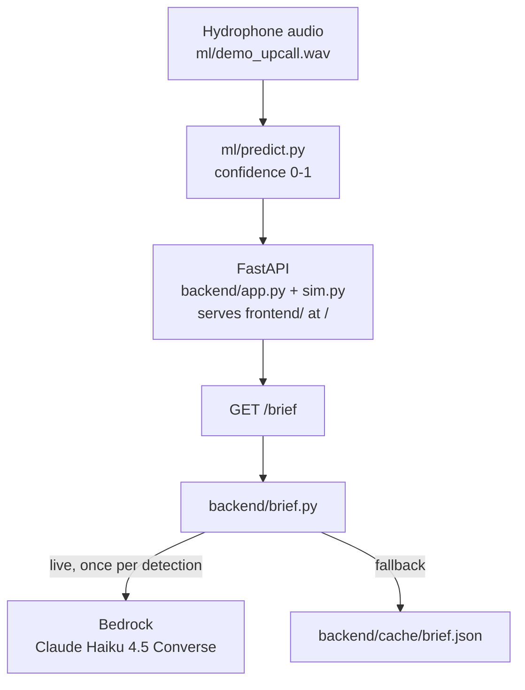
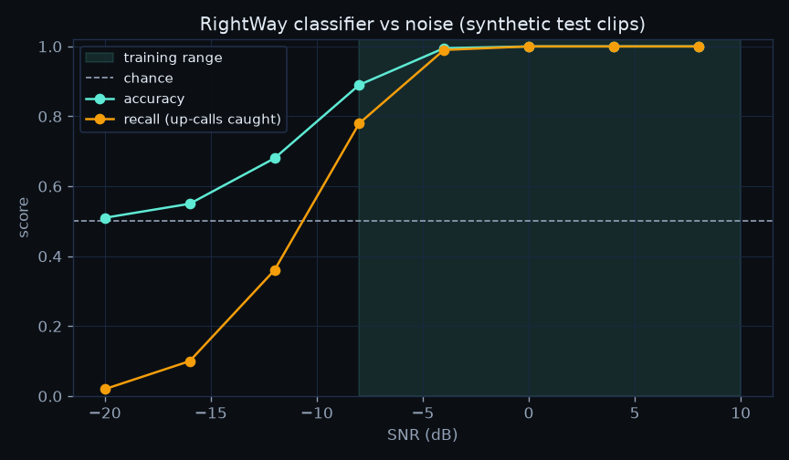

# RightWay

**Hear the whale. Slow the ship.**

RightWay detects North Atlantic right whale up-calls from hydrophone audio,
issues a 10 nm slow zone, shows simulated ship responses, and generates an AI
brief for harbor authorities.

- **Live demo:** [http://<EC2-ELASTIC-IP>:8000/](http://3.149.149.129:8000) Hosted on platform AWS
- **Demo video:** [https://youtu.be/CPQtlCxl3ds](https://youtu.be/2uxJtUpywj4)
- **Track:** Climate Tech & Clean Energy

## Problem

The North Atlantic right whale is critically endangered, and vessel strikes are
one of the leading causes of death. Seasonal and dynamic slow zones reduce
strike risk, but they depend on knowing where whales actually are. Acoustic
detection of up-calls is one way to locate whales in near real time so that
slow zones can be issued where they matter.

## Why RightWay: closing the loop

Since 2008, acoustic auto-detection buoys built by the Cornell Lab of
Ornithology and the Woods Hole Oceanographic Institution have listened for right
whale calls along the Boston shipping lanes and alerted passing ships. But the
response is uneven: slowing near a detection is required for some vessels (such
as LNG carriers serving the Boston terminals), while most other ships are only
encouraged to slow, and whether ships actually slow after an alert is not
measured. RightWay's contribution is that missing compliance loop —
it tracks each vessel's speed before and after an alert, computes a compliance
percentage, and generates a plain-language brief naming any non-complying
vessel. Detection here is a stand-in for real systems, not a replacement.

Sources: [WHOI press release](https://www.whoi.edu/press-room/news-release/new-whale-detection-buoys-will-help-ships-take-the-right-way-through-marine-habitat) · [DOSITS: real-time passive acoustic sensors](https://dosits.org/galleries/technology-gallery/observing-and-monitoring-marine-animals/real-time-passive-acoustic-sensors/)

## Who benefits

- **Harbor authorities and port operators** — a live view plus a ready-to-send brief naming any non-complying vessel.
- **NOAA / Coast Guard liaisons** — a compliance metric showing whether an alert changed vessel behavior.
- **Shipping operators** — a clear, early signal to slow down and avoid a strike.

It scales by swapping the demo pieces for real ones: real hydrophone feeds, real
AIS, and more hydrophones across more lanes.

## Solution

Hydrophone up-call detection -> a 10 nm slow zone around the detection ->
simulated ship responses (slow down or not) -> an AI brief summarizing the
situation for harbor authorities.

Ships move live on the map: motion is simulated and time-accelerated (×60), each
ship ping-ponging within 1.5 nm of its seed. After an alert, slowed vessels
visibly move slower while a non-complying vessel keeps its speed.

## Architecture



Endpoints (from `backend/app.py`):

- `GET /vessels` -> `[{id,name,type,lat,lon,heading,speed,status,simulated:true}]`, status in `normal|alerted|complying|not_complying`; `lat/lon/heading` are live (ships move).
- `GET /hydrophones` -> `[{id,lat,lon,simulated:true}]` for H-1 to H-4.
- `POST /detections {"hydrophone_id","wav"}` -> `{detection_id, hydrophone_id, confidence, zone{lat,lon,radius_nm}, vessels_in_zone[{id,name,speed_before}], synthetic_demo_clip:true, simulated:true}`. Confidence comes from `ml.predict.predict` (never hard-coded; model failure -> 503). Only one detection at a time: a second POST before `/reset` returns 409.
- `GET /compliance` -> `{compliance_pct, vessels[{id,name,before,after,status}], simulated:true}`; `compliance_pct` is `null` until the vessels have responded.
- `GET /brief` -> before/until the vessels respond, the cached `backend/cache/brief.json` with `{"brief","source":"cache"}`. Once they respond, it builds the brief from live sim state and calls Bedrock **once per detection** (cached in memory, cleared on `/reset`), returning `{"brief","source":"bedrock"|"cache","detection_id","generated_at"}`.
- `GET /stats` -> `{detections, alerts_sent, compliance_pct, simulated:true}`, from sim events only.
- `POST /reset` -> `{"ok":true}`; restores seed positions and clears the detection and the per-detection brief cache.
- `GET /static/{filename}` -> read-only ML assets (allow-list: `demo_spectrogram.png`, `demo_spectrogram.json`, `noise_spectrogram.png`, `demo_upcall.wav`); `/` serves the `frontend/` static site (single-server hosting).

## How we built it in Kiro

We used Kiro **spec-driven** for the core features (requirements -> design ->
tasks before code) and **vibe mode** for smaller fixes and follow-ups.

**Steering** (`.kiro/steering/`):

- `product.md` — product scope, honesty rules, the metrics rule, and required UI/docs copy.
- `tech.md` — stack (FastAPI, pytest, ruff, torch + librosa, Leaflet, Bedrock) and the `.venv` rule.
- `structure.md` — ownership, the API contract, the demo canon, and the workflow.

**Specs** (`.kiro/specs/`):

- `classifier/` — the ML pipeline (synthetic data -> features -> CNN -> `predict()`).
- `ai-brief/` — `backend/brief.py`: Bedrock Converse brief with a cached fallback.
- `backend-sim/` — vessel simulation + FastAPI endpoints (`backend/sim.py`, `backend/app.py`).
- `frontend-map/` — Leaflet map UI (`frontend/`).

**Hooks** (`.kiro/hooks/`):

- `lint-and-test.json` — on `*.py` save, runs venv `ruff` on the file and `pytest` for its folder.
- `readme-reminder.json` — on `.kiro/specs/` changes, reminds us to update this README.
- `honesty-guard.json` — on save of `frontend/`, `README.md` or `docs/`, checks `product.md`'s copy/metrics rules.

**What worked best:** we wrote the honesty rules once in steering, then turned
each into code. When the model drifted (arrows instead of "to", "percent"
instead of "75%", merged sentences), we added a validation check and a test for
each problem in vibe mode, keeping a deterministic cached fallback. Writing
specs first also kept our two halves in sync: a spec review caught mismatched
vessel IDs and a wrong zone center in the brief before the demo.

**Property-based testing** (Hypothesis):

- `tests/test_properties.py` — haversine is symmetric/non-negative and obeys the
  triangle inequality; `compliance_pct` stays in `[0,100]`, equals
  `complying/in-zone*100`, and a vessel complies iff after-speed <= 10 kn;
  `reset()` is idempotent; only one active detection is allowed; `resolve_wav`
  rejects paths outside `ml/`; and the cached brief passes validation (arrows
  and digits-glued-to-letters are rejected).
- `tests/test_sim_movement.py` — under movement, for any clock and detection
  time exactly Blue Fin II, Nordic Tide, Harbor Queen and Cape Runner are within
  10 nm of H-2 and every ship stays within 1.5 nm of its seed; a slowed ship
  covers less distance per simulated minute while Cape Runner stays fast; and
  `reset()` restores seed positions.

## Run it

Use **Python 3.14** (PyTorch has no 3.15 wheels yet). Setup and run (serves the
API and the frontend on one port):

```bash
python3.14 -m venv .venv
source .venv/bin/activate
pip install -r requirements.txt
python -m uvicorn backend.app:app --host :: --port 8000
# open http://localhost:8000/
```

`--host ::` (IPv6 any) avoids a Safari "Load failed" on macOS. For the live
brief, set `AWS_REGION` and `BEDROCK_MODEL_ID`; otherwise the cached brief shows.

Tests:

```bash
ruff check . && pytest -q
```

Regenerating assets:

```bash
python -m ml.make_synthetic   # writes the synthetic dataset under ml/data/
python -m ml.train            # trains UpCallCNN, writes ml/model.pt + ml/metrics.json
python -m ml.export_demo      # writes the demo spectrogram/clip assets
python -m ml.cache_demo       # writes ml/demo_result.json from predict()
python -m backend.brief       # needs AWS_REGION + BEDROCK_MODEL_ID (else cached brief)
```

## Testing instructions (for judges)

1. Open the live demo link (plain **http**, not https).
2. Click **Simulate whale call**.
3. Wait ~4 seconds for the ships to respond.
4. Read the AI brief (labelled BEDROCK when generated live, CACHED on fallback).
5. Click **Reset** to start over.

If **Simulate whale call** stays disabled and the spectrogram card shows
"Detection failed: A detection is already active. Reset first.", another visitor
already started a detection: click **Reset**, then try again.

All visitors share one simulation, so you may see a detection another visitor
started. All vessel data is simulated and the detection clip is synthetic.

## Data and honesty

- All vessel data is **simulated**; API responses include `"simulated": true`.
- The classifier is trained on **synthetic** up-calls because the Kaggle
  right-whale challenge download was blocked (403 on the rules page).
- The demo clip is synthetic and scores **1.00** — this shows the pipeline works end to end, not real-world accuracy.
- The brief is generated **live, once per detection** by **Claude Haiku 4.5** on
  Amazon Bedrock (model id `global.anthropic.claude-haiku-4-5-20251001-v1:0`)
  via the Converse API. `backend/brief.py` accepts the output only when it is
  exactly 3 sentences, contains "right whale up-call", "10 nm" and "simulated",
  includes the compliance percentage (e.g. `75%`), and has no `->`/`→` arrows or
  double-quotes (and no digit glued to a letter). If Bedrock is unavailable or
  the output fails any check, it falls back to the cached brief in
  `backend/cache/brief.json`; the UI labels the brief BEDROCK or CACHED.
- This is a screening aid, not a replacement for official NOAA systems.

## Results

Metrics from `ml/metrics.json`, **on synthetic validation data** (not real-world accuracy):

| Model                        | Metric            | Value  |
| ---------------------------- | ----------------- | ------ |
| UpCallCNN                    | best val accuracy | 0.9975 |
| UpCallCNN                    | best val AUC      | 1.0    |
| Logistic-regression baseline | val accuracy      | 0.9675 |

### SNR evaluation

How the classifier degrades as the up-call gets quieter, from `ml/snr_eval.json`
(**synthetic data**, seed 2024, 200 clips per SNR; trained over −8 to +10 dB):

| SNR (dB) | Accuracy | AUC    | Recall |
| -------- | -------- | ------ | ------ |
| -20      | 0.51     | 0.7453 | 0.02   |
| -16      | 0.55     | 0.8332 | 0.1    |
| -12      | 0.68     | 0.9677 | 0.36   |
| -8       | 0.89     | 0.999  | 0.78   |
| -4       | 0.995    | 1.0    | 0.99   |
| 0        | 1.0      | 1.0    | 1.0    |
| 4        | 1.0      | 1.0    | 1.0    |
| 8        | 1.0      | 1.0    | 1.0    |

In short: detection is reliable from about −4 dB upward, degrades around −8 dB
(recall 0.78), and misses most calls below −12 dB, which is why real recordings
are the next step.



## Limitations and next steps

- Real hydrophone feeds instead of a single demo clip.
- Real AIS vessel data instead of the simulation.
- Real labeled up-calls (e.g. licensed Cornell/Kaggle data, with attribution).
- Validation with NOAA.
- A single shared simulation serves all visitors (no per-visitor state).

## Deploy

Deployment target (placeholder):

- **Amazon EC2** — Amazon Linux 2023, `t3.small`.
- **Bedrock via an IAM instance role** — no AWS keys stored on the server.
- **systemd service** running the app on port 8000.

## Team

- Kirtan Patel 
- Bhoomika Monthy Rajashekar 
